# TeamForge Platform Architecture & Technical Reference

TeamForge is an intelligent, high-trust campus team formation and collaboration platform built for college hackathons and engineering project competitions.

---

## 1. Why MongoDB Instead of the Originally Planned Supabase

The TeamForge platform was originally envisioned around a Supabase/PostgreSQL relational architecture with row-level security. During architectural prototyping, MongoDB (via Mongoose) was selected to match the dynamic, hierarchical nature of campus hackathon team structures. Hackathon team listings require deeply nested, heterogeneous roles with variable required and preferred skill arrays, nested prior team members, flexible deliverables, and dynamic multi-stage state tracking that evolve rapidly across hackathon seasons without requiring heavy relational migration overhead. Furthermore, MongoDB's atomic document update primitives—such as array-element targeting queries (`roles.openings: { $gt: 0 }` with `$inc: { "roles.$.openings": -1 }`) and distributed atomic lease locks (`jobs` collection)—provided single-database atomic operations without needing an external message broker or Redis instance. This significantly reduced deployment complexity on free-tier web hosting (e.g., Render + MongoDB Atlas), keeping operational costs at zero while maintaining strict ACID guarantees at the document level.

---

## 2. MongoDB Collections and Data Models

### `users`
Represents student and administrator profiles.
* `name` (String, required): Student full name.
* `email` (String, required, unique, lowercase): Institutional email ending with `@kkwagh.edu.in`.
* `password` (String, required): bcrypt-hashed password (salt rounds: 10).
* `role` (String, default: "Candidate"): User role.
* `department` (String): Engineering department (e.g., Computer Engineering, Information Technology, AI & Data Science).
* `year` (String): Academic year (FE, SE, TE, BE).
* `bio` (String): Student background and technical goals.
* `profilePic` / `avatar` / `photo` (String): Base64 data URL profile photo string.
* `skills` (Array of objects): `[{ name: String, level: Number (1-5), distinctVerifiers: Number, verifiedBy: [ObjectId -> User] }]`.
* `projects` (Array of objects): `[{ title: String, description: String, link: String, techStack: String }]`.
* `pastHackathons` (Array of objects): `[{ name: String, year: String, projectTitle: String, role: String, placement: String }]`.
* `availability` (Number, 0.0 - 1.0): Candidate availability status: `1.0` = Free, `0.5` = Partly free, `0.0` = Busy/Not available.
* `portfolio` (String): URL to student portfolio or personal website.
* `linkedin` (String): LinkedIn username or profile URL.
* `isLinkedinLinked` (Boolean): Flag indicating linked LinkedIn account.
* `linkedinId` (String): LinkedIn member ID.
* `isProfileHidden` (Boolean): User privacy toggle to hide profile from discover and leaderboard.
* `emailNotifications` (Boolean): User toggle for email delivery of platform notifications.
* `isEmailVerified` (Boolean): Institutional email verification flag.
* `emailVerificationToken` (String, hashed): One-time verification token.
* `emailVerificationExpires` (Date): Verification token expiry (24 hours).
* `resetPasswordToken` (String, hashed): Forgot-password token.
* `resetPasswordExpires` (Date): Password reset token expiry (30 minutes).
* `passwordChangedAt` (Date): Timestamp when password was last updated.
* `isGithubVerified` (Boolean): Flag indicating verified GitHub account.
* `githubId` (String): GitHub user ID.
* `githubUsername` / `github` (String): GitHub profile handle.
* `githubData` (Object): Synced public statistics: `{ reposCount: Number, totalCommits: Number, languages: [String], topRepos: [{ name, html_url, description, stargazers_count, language, updated_at }], cachedAt: Date, rateLimitedUntil: Date }`. Zero token persistence.
* `lockedEvents` (Array of Strings): Event IDs where candidate is committed to a locked team.
* `credibility` (Number, 0.0 - 1.0): Candidate credibility term ($C$).
* `teammateRating` (Number, 0.0 - 1.0): Aggregate peer rating normalized from 5-star reviews.
* `reviewCount` (Number): Number of revealed post-event peer reviews.
* `competitionWins` (Number): Verified wins count.
* `uniqueShortlisters` (Number): Number of unique team leads who shortlisted this candidate.
* `isAdmin` (Boolean): Campus administrator privilege flag.
* `isOrganizer` (Boolean): Student club or hackathon organizer privilege flag.
* `organizerStatus` (String, enum): `NONE`, `PENDING`, `APPROVED`, `REJECTED`.
* `organizationName` (String): Campus club / council name for organizers.
* `organizerReason` (String): Statement of intent submitted for organizer status.
* `lastActive` (Date): Timestamp of most recent user interaction.

### `events`
Campus hackathons and engineering competitions.
* `name` (String, required): Event title.
* `organizer` (String, required): Organizing student chapter, department, or company.
* `date` (Date, required): Official event date.
* `deadline` (Date, required): Registration and team formation closing deadline.
* `mode` (String, enum): `Online`, `Offline`, `Hybrid`.
* `link` (String): Official competition link.
* `description` (String): Event details, problem tracks, and eligibility.
* `isPromoted` (Boolean): Pinned spotlight banner flag.
* `promotedTagline` (String): Subtitle for featured events.
* `prizePool` (String): Competition prize pool description.
* `createdBy` (ObjectId -> User): Creator user reference.

### `team_requirements`
Team openings posted by team leaders.
* `projectName` (String, required): Project or idea title.
* `theme` (String, required): Competition track or domain.
* `eventId` (ObjectId -> Event, optional): Associated hackathon.
* `createdBy` (ObjectId -> User, required): Team leader reference.
* `teamSize` (Number, 1-20): Target team capacity.
* `projectRequirement` (String): Problem statement and system architecture goals.
* `deliverables` (String): Expected prototype outcomes.
* `deadline` (Date): Application deadline.
* `roles` (Array of objects): Subdocuments defining open positions:
  * `title` (String): Position title (e.g., "Full-Stack Developer").
  * `requiredSkills` (Array of Strings): Mandatory skills.
  * `preferredSkills` (Array of Strings): Nice-to-have skills.
  * `proficiency` (String, enum): `Intermediate`, `Advanced`, `Expert`.
  * `openings` (Number, >= 0): Open spots remaining for this specific role.
* `existingMembers` (Array of objects): `[{ name: String, role: String }]`.
* `status` (String, enum): `OPEN`, `CLOSED`.

### `team_request_actions`
Unified state machine table for all interaction requests (both invites and applications).
* `direction` (String, enum, required): `INVITE` (lead invites candidate) or `APPLY` (candidate applies to team).
* `senderId` (ObjectId -> User, required): Initiator of the action.
* `receiverId` (ObjectId -> User, required): Recipient of the action.
* `teamRequirementId` (ObjectId -> TeamRequirement, required): Targeted team opening.
* `eventId` (ObjectId -> Event, optional): Associated hackathon.
* `role` (String, required): Target role title.
* `status` (String, enum): `PENDING`, `ACCEPTED`, `CONFIRMED`, `LOCKED`, `DECLINED`, `EXPIRED`, `ROLE_FILLED`.
* `confirmedByRequester` (Boolean): True once the original sender confirms match.
* `confirmationExpiresAt` (Date): 24-hour timeout window for requester confirmation.
* `expiresAt` (Date): 7-day timeout window for pending actions.
* `reminderSentAt` (Date): Idempotency timestamp for 24h expiration warning email.
* `senderContactConsent` (Boolean): Initiator contact sharing consent.
* `receiverContactConsent` (Boolean): Recipient contact sharing consent.

### `team_reviews`
Double-blind post-event peer evaluations and skill endorsements.
* `reviewerId` (ObjectId -> User): Review author.
* `revieweeId` (ObjectId -> User): Teammate evaluated.
* `eventId` (ObjectId -> Event): Associated hackathon.
* `teamRequirementId` (ObjectId -> TeamRequirement): Associated team.
* `technicalRating` (Number, 1-5): Technical capability rating.
* `collaborationRating` (Number, 1-5): Teamwork and communication rating.
* `punctualityRating` (Number, 1-5): Reliability and deadline adherence rating.
* `overallScore` (Number, 1-5): Weighted average rating.
* `feedback` (String): Constructive feedback (min 10 chars).
* `verifiedSkills` (Array of Strings): Skill endorsements from peer.
* `isRevealed` (Boolean): Double-blind reveal flag (true only when both peers review or deadline elapses).

### `notifications`
In-app alerts and notifications.
* `userId` (ObjectId -> User): Recipient.
* `title` (String): Alert heading.
* `subtitle` (String): Descriptive text (strictly excludes unmasked private contact information).
* `type` (String, enum): `info`, `success`, `warning`, `danger`.
* `actionId` (ObjectId -> TeamRequestAction, optional): Related action.
* `link` (String): Navigation path.
* `read` (Boolean): Unread badge indicator.

### `feedbacks`
Platform user satisfaction ratings.
* `userId` (ObjectId -> User, optional): Submitting student.
* `rating` (Number, 1-5): Star rating.
* `category` (String, enum): `general`, `matching`, `ui_ux`, `bug`, `feature_request`.
* `comment` (String): Student comments.

### `shortlists`
Tracking saved/shortlisted candidates.
* `userId` (ObjectId -> User): Student who was shortlisted.
* `shortlistedBy` (ObjectId -> User): Team lead who shortlisted.

### `announcements`
Event-day pinned banner announcements.
* `title` (String): Banner headline.
* `text` (String): Detailed broadcast message.
* `active` (Boolean): Visibility flag.
* `expiresAt` (Date): Automatic banner hide timestamp.
* `createdBy` (ObjectId -> User): Admin publisher.

### `jobs`
MongoDB distributed lease locks for the background scheduler.
* `_id` (String): Unique lock name (e.g., `scheduler_cron_lock`).
* `lockedAt` (Date): Lock acquisition timestamp.
* `expiresAt` (Date): Lease expiration timestamp for auto-recovery.

---

## 3. Application Routes by Feature

| Feature | Method & Route | Access Control | Description |
| :--- | :--- | :--- | :--- |
| **System** | `GET /healthz` | Public | Readiness and liveness probe (checks DB connectivity) |
| **Authentication** | `GET /signup`, `POST /signup` | Public | Student signup with institutional `@kkwagh.edu.in` validation |
| | `GET /login`, `POST /login` | Public | Rate-limited authentication |
| | `GET /verify-email`, `GET /resend-verification` | Public | One-time token institutional email verification |
| | `GET /forgot-password`, `POST /forgot-password` | Public | Time-limited password reset dispatch |
| | `GET /reset-password/:token`, `POST /reset-password` | Public | Secure token-authenticated password update |
| | `GET /logout` | Authenticated | Session destruction |
| | `GET /auth/github`, `GET /auth/github/callback` | Authenticated | GitHub OAuth link and stat synchronization |
| **Profile & Settings**| `GET /profile`, `POST /profile` | Authenticated | Student skills, bio, portfolio, and contact management |
| | `POST /profile/privacy` | Authenticated | Toggle `isProfileHidden` and `emailNotifications` |
| **Discover & Search** | `GET /` | Public / Auth | Landing page & active team requirements preview |
| | `GET /discover` | Public / Auth | Paginated search (10/page) with skill, event, and keyword filters |
| | `GET /leaderboard` | Public / Auth | Campus leaderboard (top 50) with reputation metrics |
| | `GET /how-it-works` | Public | 4-step interactive platform onboarding workflow |
| **Team Requirements** | `GET /team-requirement/new` | Authenticated | Multi-step wizard: context, define-team, roles, review |
| | `POST /team-requirement/submit` | Authenticated | Validates and persists requirement; locks lead for event |
| | `GET /team-requirement/:id` | Authenticated | Detail page with matched candidate discovery |
| | `GET /team-requirement/:id/recommendations` | Owner Only | Scored candidate recommendation endpoint |
| **Actions: Invites** | `POST /invites/send` | Team Lead Only | Creates `INVITE` action (direction: `INVITE`, status: `PENDING`) |
| | `POST /invites/:id/accept` | Candidate Only | Candidate accepts; status transitions to `ACCEPTED` |
| | `POST /invites/:id/confirm` | Team Lead Only | Lead confirms; transitions to `LOCKED`; decrements opening |
| | `POST /invites/:id/decline` | Candidate / Lead | Declines invitation; status transitions to `DECLINED` |
| | `POST /invites/:id/consent` | Team Members | Mutual contact sharing consent toggle |
| **Actions: Applications**| `POST /applications/apply` | Candidate Only | Creates `APPLY` action (direction: `APPLY`, status: `PENDING`) |
| | `POST /applications/:id/accept` | Team Lead Only | Lead accepts; status transitions to `ACCEPTED` |
| | `POST /applications/:id/confirm` | Candidate Only | Candidate confirms; transitions to `LOCKED`; decrements opening |
| | `POST /applications/:id/decline` | Candidate / Lead | Declines application; status transitions to `DECLINED` |
| | `POST /applications/:id/consent` | Team Members | Mutual contact sharing consent toggle |
| | `GET /applications/team/:id` | Team Lead Only | View list of candidates who applied to team |
| **Events** | `GET /events` | Public / Auth | Complete list of campus events and hackathons |
| | `GET /events/new`, `POST /events/new` | Admin / Organizer | Create and publish campus hackathon event |
| | `GET /events/:id` | Public / Auth | Hackathon detail page with associated teams |
| | `POST /events/:id/promote` | Admin / Organizer | Toggle promoted banner settings |
| **Reviews & Verification** | `GET /reviews` | Authenticated | Double-blind review opportunities and received ratings |
| | `POST /reviews/submit` | Authenticated | Submit double-blind teammate review and skill endorsements |
| **Feedback** | `POST /feedback` | Authenticated | Submit 1-5 star user feedback with rate limiting |
| **Admin Panel** | `GET /admin/stats` | Admin Only | Real-time platform metrics (all-time & last 7 days) |
| | `GET /admin/stats/export` | Admin Only | Anonymous platform stats CSV export with formula escaping |
| | `GET /admin/feedback` | Admin Only | View student feedback list (capped at 200) |
| | `GET /admin/feedback/export` | Admin Only | Anonymous feedback CSV export with formula escaping |
| | `GET /admin/banner`, `POST /admin/banner` | Admin Only | Event-day pinned announcement banner controls |
| | `GET /admin/organizers` | Admin Only | Review student club organizer status applications |

---

## 4. Unified Action State Machine

Every team match follows a symmetric 4-stage lifecycle governed by `utils/actionStateMachine.js`. The state machine operates identically for both `INVITE` and `APPLY` directions:

```mermaid
stateDiagram-v2
    [*] --> PENDING: createAction() [INVITE or APPLY]
    
    PENDING --> DECLINED: declineAction() [Recipient declines]
    PENDING --> EXPIRED: scheduler check [7 days elapsed]
    PENDING --> ACCEPTED: acceptAction() [Recipient accepts]
    
    ACCEPTED --> DECLINED: declineAction() [Either party declines]
    ACCEPTED --> EXPIRED: scheduler check [24h confirmation elapsed]
    ACCEPTED --> LOCKED: confirmAction() [Original Requester confirms]
    
    LOCKED --> ROLE_FILLED: Other pending actions when openings reach 0
    LOCKED --> [*]: Team locked for event; contact consent unlocked
```

### Key Concurrency Invariants
1. **Acceptance Is Never Final**: `acceptAction()` merely transitions the action to `ACCEPTED` and starts a 24-hour confirmation timer (`confirmationExpiresAt`). The candidate is **not** locked, and the role openings are **not** decremented.
2. **Requester Confirmation**: Only the initiating user who originally submitted the request confirms the match.
3. **Atomic Spot Allocation**: `confirmAction()` atomically claims the opening via MongoDB `findOneAndUpdate` with `{ "roles.openings": { $gt: 0 } }`. If openings reach 0, all competing pending actions are automatically updated to `ROLE_FILLED`.
4. **Event-Scoped Locking**: A confirmed candidate is appended to `lockedEvents` strictly for that specific competition. They remain fully eligible for other events.

---

## 5. Candidate Matching Engine & Leaderboard Formulas

### Candidate MatchScore Engine (`utils/matchScore.js`)

The matching engine scores and ranks candidates for a given team opening:

$$\text{MatchScore} = \text{round}(100 \times (0.40 \cdot S + 0.25 \cdot C + 0.20 \cdot R + 0.10 \cdot A + 0.05 \cdot T))$$

Where:
* **Skill Match Term ($S \in [0, 1]$)**:
  * For each required skill: $\min(1, \text{candidateLevel} / \text{targetLevel})$, where proficiency targets are `Intermediate` = 3, `Advanced` = 4, `Expert` = 5 (missing required skills score 0).
  * Averaged across all required skills.
  * Preferred skill bonus: $+0.05$ per matched preferred skill up to a maximum bonus of $+0.10$ (capped at $1.0$).
  * **Hard Qualification Filter**: Candidates appear in recommendations and search results **only** if they cover at least $50\%$ of the required skills (`minRequiredSkillCoverage = 0.50`).
* **Credibility Term ($C \in [0, 1]$)**:
  $$C = 0.30 + 0.40 \cdot (\text{isGithubVerified}) + 0.30 \cdot \text{peerShare}$$
  Where $\text{peerShare}$ is the candidate's average over claimed skills of $\min(1, \text{distinctVerifiers} / 3)$. Derived dynamically on calculation.
* **Reputation Term ($R \in [0, 1]$)**:
  $$R = 0.40 \cdot W + 0.40 \cdot Q + 0.20 \cdot H$$
  * $W = \text{win points} / 5$ (college win = 1, state win = 2, national win = 3, capped at 1.0).
  * $Q = \text{average review rating} / 5.0$ (from double-blind teammate reviews; defaults to neutral 0.5 if unreviewed).
  * $H = \min(1, \text{uniqueShortlisters} / 10)$.
  * Missing reputation components default to neutral 0.5.
* **Availability Term ($A \in [0, 1]$)**:
  * Excluded (scores 0.0 / filtered) if the candidate is locked for this specific competition event or if `isProfileHidden` is enabled.
  * Otherwise evaluated directly from `user.availability`: `1.0` = Free, `0.5` = Partly free, `0.0` = Busy.
* **Activity Recency Term ($T \in [0, 1]$)**:
  * Last active within $\le 7$ days: $1.0$
  * Last active within $\le 30$ days: $0.6$
  * Inactive $> 30$ days: $0.2$

### Campus Leaderboard Formula (`utils/leaderboardService.js`)

The campus leaderboard scores students across 24-hour cached snapshots:

$$\text{LeaderboardScore} = \text{round}(100 \times (0.70 \cdot \text{Reputation} + 0.30 \cdot \text{Activity Recency}))$$

* **Reputation Component**: $R = 0.40 \cdot W + 0.40 \cdot Q + 0.20 \cdot H$ (reputation term from matching engine).
* **Activity Recency Component**: $T = 1.0$ ($\le 7$d), $0.6$ ($\le 30$d), $0.2$ ($> 30$d).
* **5-Stage Deterministic Tie-Breaker**:
  1. Highest Leaderboard Score
  2. Highest Raw Hackathon Win Points ($W$)
  3. Highest Unique Shortlist Count ($H$)
  4. Highest Profile Completeness Percentage
  5. Alphabetical by Student Name

---

## 6. Verification and Trust Model

1. **Institutional Identity**:
   * Restricted registration strictly requiring `@kkwagh.edu.in` email addresses.
   * Cryptographically secure SHA-256 hashed one-time verification tokens sent via institutional SMTP.
2. **GitHub Activity Verification**:
   * **OAuth Linkage (`GET /auth/github` -> `GET /auth/github/callback`)**: Exchanges authorization code for an ephemeral OAuth token in-memory, verifies user identity, pulls public repositories, commit counts, and language distribution, and sets `isGithubVerified = true`. **Zero Token Persistence**: Access tokens are never stored in the database.
   * **Public REST API Fallback (`POST /auth/github/verify`)**: Allows students to submit a public GitHub username (or profile URL). The server queries GitHub's unauthenticated public REST API (`api.github.com/users/:username` and `/repos`). If the profile exists, public statistics are synced and `isGithubVerified = true` is set. *Note*: This public REST API path verifies account existence and pulls public activity, but does not prove account ownership as no OAuth handshake or password login is required.
3. **Post-Event Double-Blind Reviews**:
   * Teammates locked into an event evaluate each other after the event date passes (`routes/reviews.js`).
   * Reviews remain hidden until both teammates submit their reviews, preventing retaliatory scores.
   * Endorsed skills increment the candidate's verified skill count on their profile.
4. **Privacy and Safety Controls**:
   * Personal contact details (phone, email, socials) are masked by default. Contact details are revealed only when both teammates mutually opt into contact sharing after being locked into a team.
   * `isProfileHidden` enables students to temporarily remove themselves from discovery and public leaderboards.
